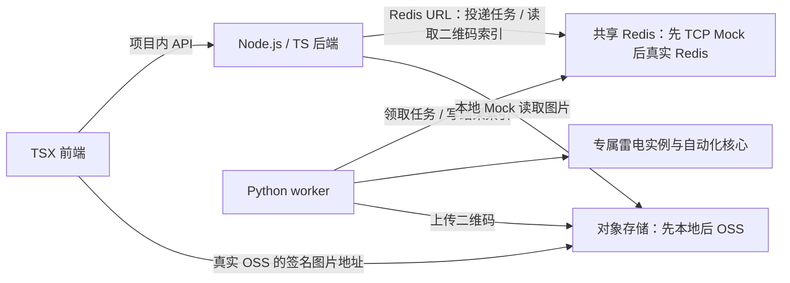

# 扫码登录：任务队列、对象存储与日常接续

更新：2026-09-23。状态：历史设计方案，正文保留当时的范围与待验证项。后续实现已调整为真实 Redis、OSS 和固定双实例池，当前实现说明见 [codex/qr-login-service 分支的服务端 README](https://github.com/HUY5877/NarutoDailyADB/blob/codex/qr-login-service/naruto_daily/login_service/README.md)。扫码后接续日常仍待实现。

## 目标与已确定范围

客户端是一个完整的 TypeScript 全栈项目：TSX 前端生成唯一 taskId，交给项目内的 Node.js/TypeScript 后端直接连接 Redis 并投递任务。Python worker 独立消费同一队列，为任务分配专属雷电实例，获取 QQ 授权二维码并上传对象存储。TS 后端按 taskId 读取 Redis 中的二维码索引，前端显示图片。手机确认授权后，worker 在同一实例继续完整日常。客户端项目与 Python worker 通过 Redis 和对象存储协作，不直接调用对方接口。

- 登录渠道：QQ 的“与安卓好友玩”，不是微信或 iOS 渠道。
- 区服：按用户确认，第一版沿用游戏“开始游戏”页面显示的默认区服，不额外增加区服确认步骤。
- 客户端项目包含 TSX 前端与 Node.js/TypeScript 后端；业务 worker 使用 Python。
- 第一版完成提交任务、等待并显示二维码，以及服务端扫码后继续日常。完整任务状态查询、进度面板、取消和手动刷新接口后续实现。
- 队列先模拟 Redis；对象存储先使用本地文件模拟，后续替换为阿里云 OSS。
- 三个独立 Git 仓库：现有自动化核心、Python 服务端、TypeScript 客户端。共享模拟基础设施放在服务端仓库的开发工具中，作为独立进程运行。
- 手机扫码及手机端确认由用户完成；其他登录步骤和日常接续由服务端推进。

## 全栈客户端与 Redis 连接

TSX 前端调用自己项目的 TS 后端；TS 后端使用 Node.js Redis 客户端，直接通过 `REDIS_URL` 访问共享 Redis。Python worker 使用 redis-py 连接同一个 Redis。这里不需要额外建设独立 HTTP 队列网关。[Node.js Redis 客户端](https://redis.io/docs/latest/develop/clients/nodejs/)

客户端内部的 HTTP 接口只承担提交任务与读取二维码引用；TS 后端不启动模拟器，Python worker 不向客户端开放业务接口。模拟器操作始终由 worker 执行。



Node.js 后端和 Python worker 的环境配置均使用同一个 `REDIS_URL`，例如 `redis://127.0.0.1:16379/0`。该配置不打包进 TSX 浏览器代码。生产接入真实 Redis 时替换连接配置并运行兼容性测试，客户端内部 API 保持不变。

## 已有证据

本机已验证雷电 `list2` 可查询实例；`ldconsole adb --index 0 --command get-serialno` 返回当前设备 `emulator-5554`，启动完成属性为 1。实例创建、克隆和双实例隔离仍待实测。

对用户提供的 7 张截图完成离线检查：图片均为 1958×1114，含模拟器边框。按本组截图的游戏视口 x=1、y=34、宽1920、高1080核对：

| 检查项 | 结果 |
| --- | --- |
| QQ 与安卓好友玩按钮 | 现有模板匹配 0.9983，阈值 0.85 |
| 切换账号按钮 | 现有模板匹配 1.0000，阈值 0.95 |
| 开始游戏按钮 | 现有模板匹配 0.9934，阈值 0.85 |
| 第6张图的二维码 | OpenCV 成功定位约385×385的码区 |

以上验证不证明完整登录链路已跑通。运行时必须使用 ADB 的原生截图尺寸，不能沿用带窗口边框截图的坐标偏移。未读取二维码内容或尝试使用截图中的授权信息。

## 仓库边界

| 仓库 | 职责 |
| --- | --- |
| NarutoDailyADB（现有） | 游戏页面识别、扫码页面导航、扫码后续跑入口、现有全部日常流程 |
| NarutoControlServer（新增，Python） | 队列消费、实例分配、扫码流程调度、上传二维码、任务与实例绑定；开发工具提供共享 TCP Redis Mock |
| NarutoLoginClient（新增，TSX + TypeScript） | TSX 前端展示二维码；Node.js/TS 后端原生连接 Redis，提交任务、按 taskId 读取索引并返回图片引用 |

客户端建议使用 React/TSX 与 Node.js/TypeScript 后端；worker 复用 Python 自动化核心。第一版可使用 fakeredis 的 `TcpFakeServer` 启动一个共享 Redis 协议服务，两端都通过普通 Redis 客户端连接，而不是各自创建内存队列。该能力已查阅 [fakeredis 官方文档](https://fakeredis.readthedocs.io/en/latest/)，尚未在本项目实测 Node.js 与 Python 的跨进程兼容性。

TCP Mock 的队列和索引存在内存中，重启会丢失，不能作为持久化方案验收。worker 需要将已分配实例及执行阶段记录落盘；Mock 重启后不得盲目重新分配正在执行的任务。完整的基础设施重启恢复留待真实 Redis 持久化和任务恢复联调。

自动化核心作为固定版本的 Python 依赖，本地开发使用可编辑依赖并显式指定资源目录。发布时需要把模板资源与核心版本一起交付。

任务消息与二维码结果由服务端仓库维护版本化 JSON Schema，客户端同步类型和版本。三个仓库使用同一个多目录工作区，不复制自动化代码到服务端，也不为第一版再拆第四个协议仓库。

## 登录流程

1. TSX 前端点击“获取二维码”，生成 UUID 格式的 taskId 并保存，再调用同项目 TS 后端投递 Redis 任务。同一任务重试沿用原 ID；新的独立登录任务生成新 ID。
2. worker 领取并持有该任务的执行权，记录 taskId 与实例的绑定。同一 ID 重复投递不得再分配实例；同一 ID 对应不同任务内容时拒绝提交。
3. 从未登录任何账号的模板分配专属实例，启动 Android，核对真实 ADB serial、分辨率和游戏可用状态。
4. 启动火影忍者，处理必要的协议勾选，识别并点击 QQ“与安卓好友玩”。
5. 根据实际页面依次进入“切换账号 → 添加账号 → 其他登录方式 → 扫码登录”。若干净实例直接进入某个后续页面，则从实际页面继续。
6. 确认二维码真实出现，使用 OpenCV 定位并带白边截取 PNG，上传至 `qr/{taskId}/{generation}.png`。上传完成后，再发布该 taskId 的二维码结果索引。
7. TSX 前端以 taskId 轮询自己项目的 TS 后端，由后端读取 Redis 索引；图片未生成则继续等待，失败或等待超时则显示具体提示。本地 Mock 由 TS 后端读取模拟对象并返回图片；真实 OSS 返回可下载的签名地址。
8. worker 持续检查同一实例，等待用户手机扫码及确认。网页不需要向 worker 发送“扫码成功”；不能把客户端取到图片或二维码消失直接当作授权完成。
9. 如果出现 QQ 二次授权页，处理后继续等待“开始游戏”。沿用默认区服，进入扫码后续跑入口，加载并清理弹窗，确认主界面，再执行完整日常。
10. 登录、二维码、实例、日常日志均沿用同一个 taskId。第一版不实现完整任务状态查询页面，只保留执行和恢复需要的内部阶段记录。

每次点击都应先识别当前页面、点击后等待下一页证据，设置步骤与整体超时。QQ 原生页面能够提供 UI 层级时优先使用文字/控件节点，不能取得节点时使用模板；游戏 Unity 页面使用模板。新的中间页面节点可用性需要实机验证。

二维码提取使用实际像素，保持白边和清晰度，不让大模型生成或重绘二维码，也不让多模态 API 成为获取二维码的必经步骤。

## taskId、队列与二维码索引

taskId 使用客户端生成的 UUID，定义为一次“登录并执行日常”的唯一标识，不是永久设备ID、QQ号、雷电index或Redis消息ID。[Node.js UUID 接口](https://nodejs.org/api/crypto.html#cryptorandomuuidoptions)

消息示例：

```json
{
  "version": 1,
  "taskId": "11111111-1111-4111-8111-111111111111",
  "type": "login_and_daily",
  "regionPolicy": "default",
  "createdAt": "2026-09-23T00:00:00Z"
}
```

| 数据 | 第一版 | 后续真实基础设施 |
| --- | --- | --- |
| 待处理消息 | 共享 TCP Mock 的 Stream `naruto:tasks` | 真实 Redis 的同名 Stream |
| 持久任务、实例绑定、内部阶段 | worker 本地持久记录，taskId 唯一约束 | 持久任务记录；不能随队列消息清理一起丢失 |
| 二维码结果索引 | Mock Redis 键 `naruto:qr:{taskId}` | 真实 Redis 的同名键 |
| 二维码图片 | 本地对象目录 `qr/{taskId}/{generation}.png` | 私有 OSS Bucket，同样的对象键 |

二维码结果只需包含 taskId、generation、objectKey、可下载地址及地址有效期；未就绪与生成失败由索引读取接口表达。这是获取二维码必需的结果通道，不扩展成用户暂缓的通用任务状态系统。

客户端项目自己的 TS 后端提供 `POST /api/tasks`、`GET /api/tasks/{taskId}/qr`，供 TSX 前端使用。worker 直接使用 Redis 领取任务、续租、发布二维码引用、确认完成或失败。前端不取得任意 Redis 命令、ADB 命令或本地文件路径的执行能力。

TS 后端在 Redis 中原子完成任务幂等检查与入队；相同 taskId 与相同内容返回已有任务，同 ID 不同内容返回冲突。worker 再以持久任务记录和实例绑定防止重复分配。上传图片成功后再原子发布索引，避免客户端拿到尚不存在的图片。相关原子命令及 Streams 消费行为须用 Node.js/redis-py 同时连接 Mock 的集成测试验证。

worker 领取后持续持有并续租，从出码、等待扫码到日常结束保持同一 taskId→实例→serial 绑定。长任务在整个执行期间不能因等扫码而失去租约。只有流程完成或失败结果持久化后才确认队列消息；“二维码已上传”不等于任务全部完成。

队列使用 Streams 的消费组、确认与待处理消息回收，Mock 与真实 Redis 保持相同调用接口。消息可能重复投递，依靠任务幂等和实例绑定避免重复分配；不能声称队列可以让游戏操作恰好执行一次。worker 崩溃后的日常不能盲目从头重放，应检查任务记录和当前页面，无法可靠恢复则记录需要人工恢复。参见 [Redis Streams](https://redis.io/docs/latest/develop/data-types/streams/)。

## 本地对象存储与 OSS 替换

- 提供稳定的 `ObjectStore.put/get_url/delete` 接口。Mock 由 Python 原子写入共享目录，TS 后端按对象键读取并通过自己的图片接口展示；双方配置相同的绝对 `MOCK_OSS_ROOT` 路径，不使用各自工作目录。生产适配器由 Python 上传阿里云 OSS，返回签名图片地址。
- OSS 保持私有，worker 生成短期签名下载地址，写入二维码结果索引。客户端用 taskId 获取这个引用后直接下载图片，不需要持有 OSS 写入密钥。[OSS 私有对象与签名URL](https://www.alibabacloud.com/help/en/oss/use-a-fixed-file-url-to-access-a-file)
- taskId 只是索引，不替代访问凭据。客户端 TS 后端校验二维码请求归属；Redis Mock 仅监听回环地址，连接凭证保留在 Node.js/Python 运行环境。
- 对象按二维码代次生成不可变 key，索引指向最新代次，避免缓存旧图。OSS签名地址的有效期与QQ二维码的实际有效期分别处理，不能互相代替。
- 二维码过期或授权结束后撤销可用索引并清理图片；过期码的手动刷新接口后续实现。第一版过期后结束该次等待，并提示重新创建登录任务。
- 新任务不能直接复用包含其他账号授权数据的实例。已绑定实例与后续任务数据保留，不随二维码TTL删除。

## 接上现有日常的必要改造

现有 `启动日常.cmd` 会打开独立控制台执行 `launcher run all`，且结束后等待回车。它从完整登录流程开头执行，不能直接从用户第7张图接续。

当前登录动作顺序是：协议坐标点击 → 等待 → QQ安卓按钮 → 按旧昵称授权 → `finish_login_authorization` → 等待15秒 → 清弹窗 → 返回主界面。

应增加一个明确的扫码后续跑入口，例如 `daily_after_qr`（提议名称，目前不存在）：

1. 按动作类型定位 `finish_login_authorization`，从它开始保留登录尾部，避免写死数组下标。
2. 按 `TASK_ORDER` 拼接除 `login` 外的全部任务：一乐 → 装备 → 组织祈福/招财 → 招募 → 签到 → 体力 → 丰饶 → 生存 → 秘境。
3. 跳过最前面的渠道选择和按旧昵称切账号；扫码入口的配置加载也不能再强制依赖旧 `LOGIN_ACCOUNT_NAME`。
4. worker 直接管理 Python 任务进程和真实退出状态，并携带同一个 taskId；原双击 CMD 继续作为人工使用入口。第一版不增加客户端进度推送。

每个会话固定使用分配到的实例和显式 serial，不能覆盖共享 `config.local.json`，不能在多设备情况下回退到默认设备。模板路径与模型凭证由服务端明确传入，避免临时配置目录导致资源查找失败。

同一实例的登录导航和日常自动操作互斥。当前执行器是同步阻塞代码，任务在独立进程运行；监听器与续租不能被游戏操作阻塞，领取数量不得超过可用实例容量。第一版限制为一个活跃实例任务，完成单任务闭环后再验证并发扩展。

## 分阶段验证

| 阶段 | 验收 |
| --- | --- |
| 1. Mock 跨进程闭环 | TSX前端经本项目TS后端投递，TS后端与独立Python进程通过同一Redis URL共享任务和索引，网页按taskId显示本地模拟图片；重复提交不重复执行 |
| 2. 独立测试实例出码 | 把测试图片替换成真实雷电扫码页；实际二维码可扫码；原实例不受影响 |
| 3. 授权后续跑 | 手机确认后识别开始游戏；沿用默认区服；不切回旧账号；完整日常与二维码沿用同一taskId |
| 4. 后续真实基础设施与并发 | 接入Redis、阿里云OSS；验证租约、消息重投、双任务隔离；通用任务状态查询单独实现 |

关键异常覆盖：二维码加载失败/过期、重复点击获取、手机取消授权、未知授权页面、游戏更新、无角色或新手引导、实例掉线、服务端重启。无法进入已有角色主界面时报告具体状态，不把它当作日常任务已经启动。

第一步实施重点是可跨TS/Python进程工作的共享Mock队列与本地对象存储，再把真实二维码与现有日常串入相同taskId工作流。本轮仅更新方案，不代表已创建三个仓库或完成上述功能。
